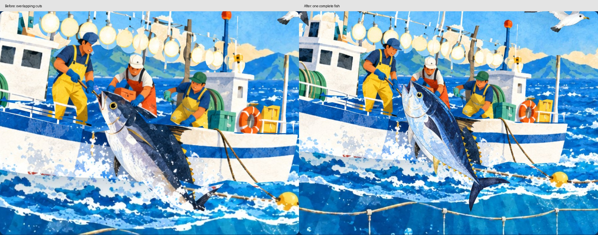
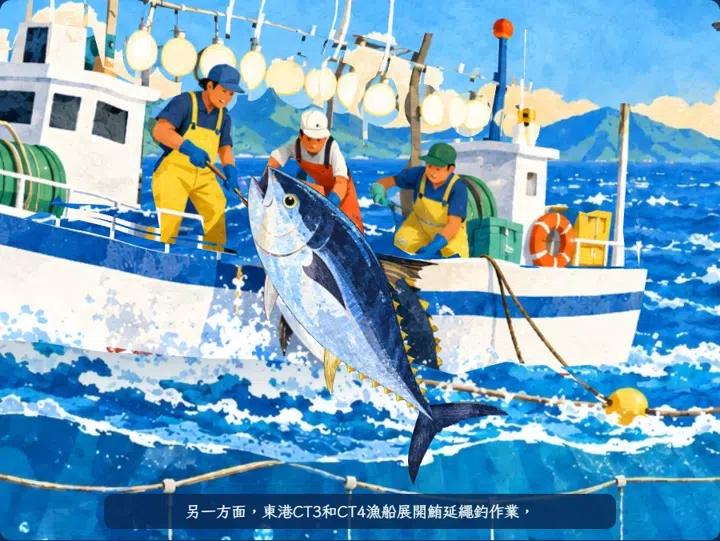
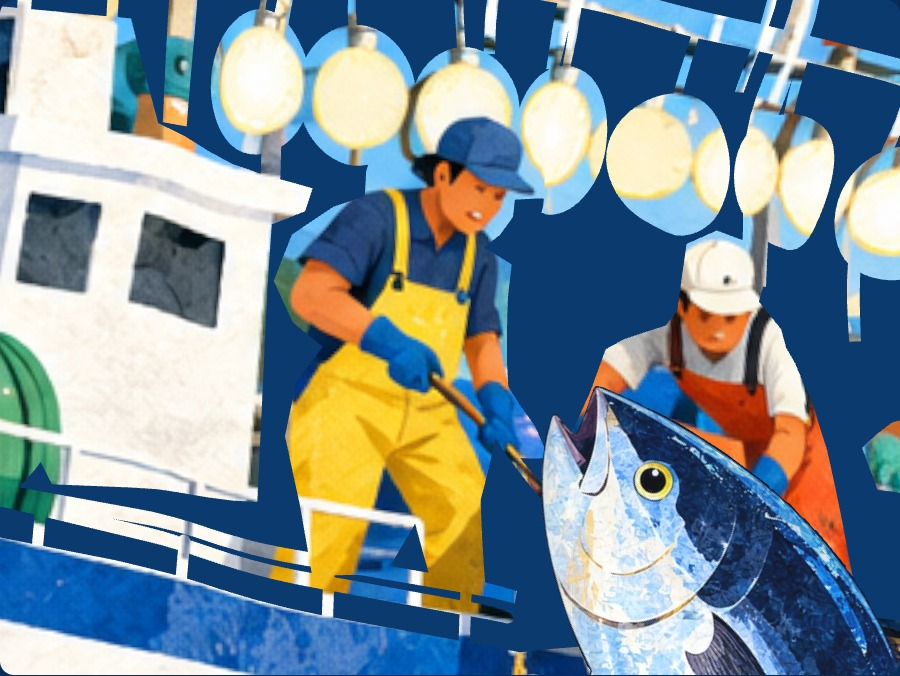
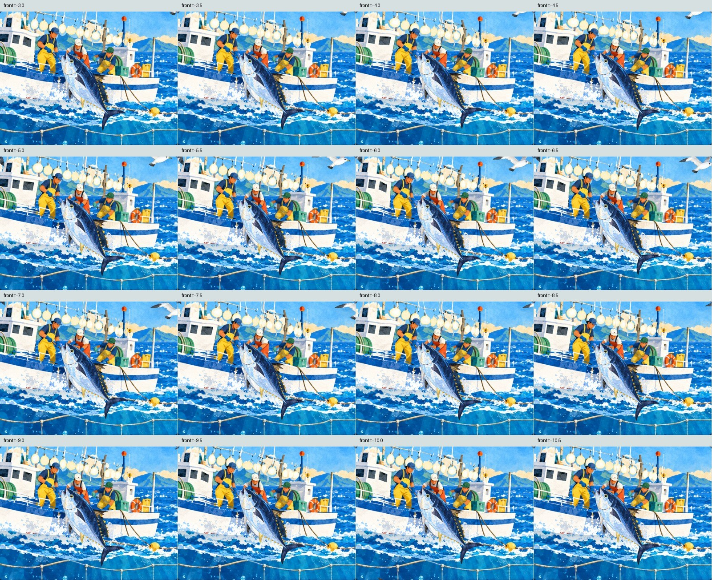
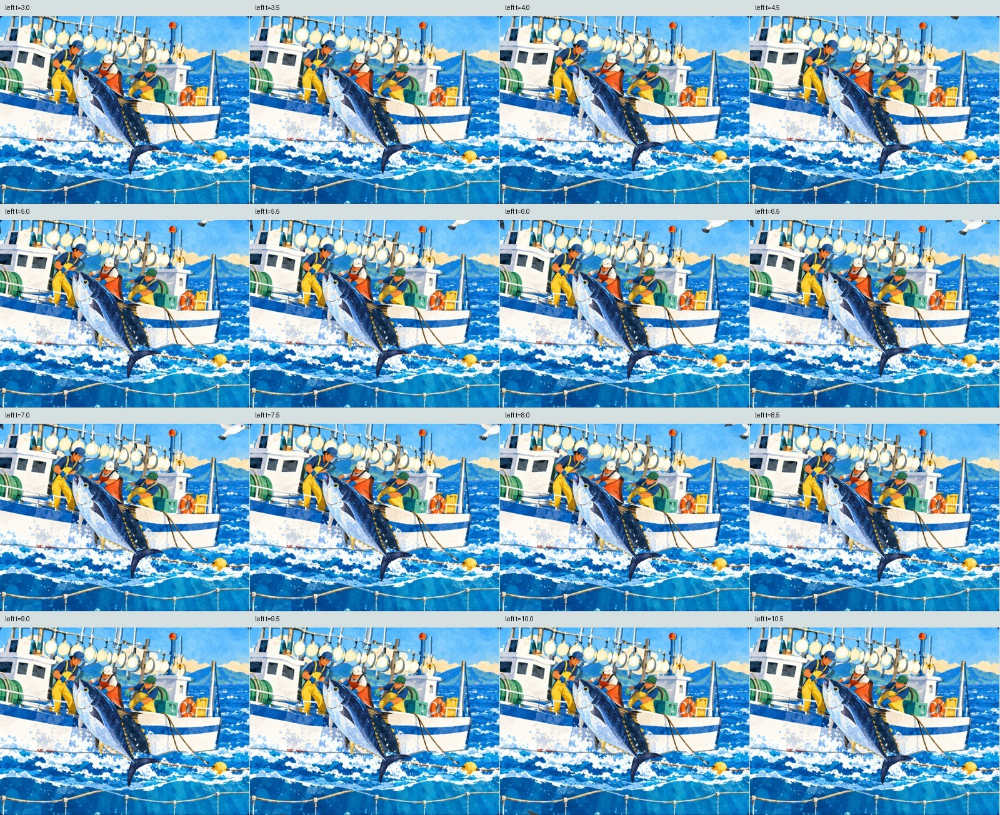
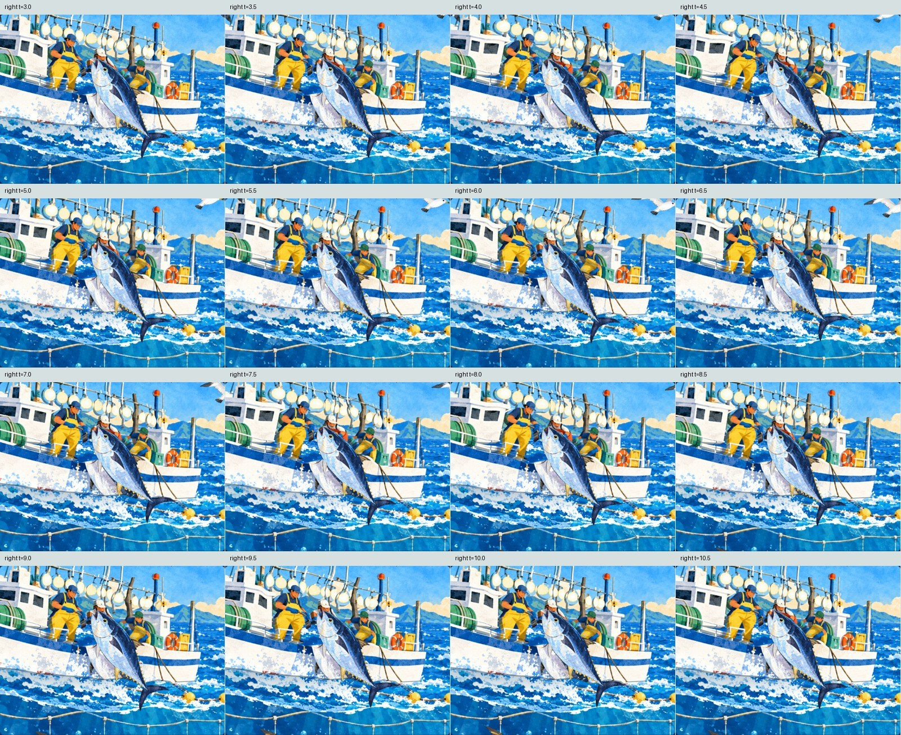

# 整隻船邊鮪魚、完整頭部與拉魚動作驗證

2026-11-01，Windows 桌面 Chromium 145、Playwright，使用嚴格的 `--autoplay-policy=user-gesture-required`。本報告的數值與圖片來自本機網站；正式站在交付網址前另行重測。

## 重現原因及修正

上一輪的船、船員、魚身、魚尾分別是重疊的原圖浮雕切片。各自變形及深度不同，會讓船身切過魚頸，魚身與尾巴也會分開；原圖尾部另有海浪遮擋。左側漁夫的手工輪廓裁到鼻子及帽子。先前只比對臉中央的小範圍色差，沒有證明整個頭部完整，這項驗證不足。

現在每艘船使用一張連續封閉曲面，保留原畫船型、人物、服裝、工具及正向構圖。三位主船漁夫採共同、連續的變形，保護完整頭部，加大腰部拉動與手套前後動作；沒有重疊的人物裁片。船邊鮪魚使用既有完整封閉魚形，魚頭、魚鰓、背腹、胸鰭、腹鰭、尾柄及兩片新月形尾鰭一起擺動。舊魚像素所在的船面以補底圖局部修復，原畫人臉仍直接來自原檔。





## 驗證結果

| 項目 | 本機實測 |
|---|---|
| 整隻船邊魚幾何 | 4,070 頂點、8,136 三角形，1 個連續組件；開口／非流形邊 0 |
| 兩艘連續船面 | 47,288 三角形，開口／非流形邊 0；主船 3 位、後船 2 位船員 |
| 整隻魚連續畫面 | 3.0～12.5 秒、每 0.1 秒取樣，共 96 個時點；和完整魚形參考比較，實際船身遮擋造成的缺失 0；最大內部洞 0 像素，始終為單一連續魚形 |
| 完整左側頭部 | 另 96 個時點；使用從原圖色彩取得的完整帽子、頭髮與臉部遮罩，比較無裁切的獨立頁面參考。最大缺失比約 0.0273%，連通比 100%，內部洞 0 像素；包含 2 像素光柵邊界容差 |
| 檢查視野 | 每個參考遮罩與畫面邊緣至少保留 10 像素，避免只拍魚身中央卻漏掉頭尾 |
| 實際彩色近照 | 原繪本正面、左斜、右斜各 16 張，共 48 張；逐張檢視整條魚、頭尾與漁夫。另重新產生並檢視 55 張逐角色／整體角度圖 |
| 拉魚動作 | 三位主船員前後拉動角度跨度均超過 0.15 弧度；左側完整頭部在放大的驗證畫面水平移動約 27.1 像素，確定實際畫面有位移 |
| 正常播放 | 未呼叫手動更新函式，連續擷取 32 張正常播放畫面，旁白時鐘從約 2.28 秒前進至 13.82 秒；魚與三位船員動作狀態同步持續改變 |
| 原畫顏色 | 三位臉部與兩處船身小範圍平均絕對色差為 0.0408、0.0298、0.0463、0.0034、0.0081／255；這項只確認顏色，完整性由上列整體遮罩檢查 |
| 實際人物區域厚度 | 主船最小約 0.03454、後船約 0.02637 書頁寬單位，從實際頂點計算 |
| 動作／外觀取樣 | 另 241 個游魚及船員動作取樣；船與魚維持原畫朝向 |
| AR 假相機 | 直式正面、輕斜、橫式留邊、橫式四種畫面，點擊到首次辨識約 2.735、2.828、3.000、3.000 秒；每種都有三段字幕及正常旁白，退出後 renderer 清除、音訊暫停 |
| 慢音訊與切換 | 音訊延遲 6 秒仍繼續播放，預覽切 AR 沒有雙旁白 |
| 返回及重開 | 載入模型時返回可取消，所有相機 tracks 結束；前景續播按鈕通過，連續進出 AR 三次通過 |
| 執行錯誤 | 上列本機測試沒有 pageerror、console error 或 HTTP 4xx/5xx |





這是保留繪本構圖的封閉立體浮雕；極端側視或背面不是另外繪製的完整人物背面。以上桌面檢查不能代替真手機、紙本、LINE 外開、實體喇叭或手機效能實測。正常播放動畫是瀏覽器畫面取樣，不能當手機 FPS 指標。

## 重現

在專案根目錄開 `python -m http.server 8000 --bind 127.0.0.1`，另開終端執行：

```powershell
python ar/tools/gen_source_boat.py
python ar/tools/verify_catch.py --out .ar-qa/catch-integrity
python ar/tools/verify_characters.py --mode original --out .ar-qa/catch-integrity/original
python ar/tools/verify_characters.py --mode visual --out .ar-qa/catch-integrity/visual
python ar/tools/verify_characters.py --mode ar --out .ar-qa/catch-integrity/ar
python ar/tools/verify_characters.py --mode regressions --out .ar-qa/catch-integrity/regressions
python ar/tools/verify_characters.py --mode lifecycle --out .ar-qa/catch-integrity/lifecycle
```

產生曲面需要 `numpy`、`shapely`、`triangle`。完整度檢查需要 `numpy`、`Pillow`、`opencv-python`、`scipy`、`playwright` 及現有 Chromium；AR 回歸另使用 `make_fixtures.py` 產生的相機輸入。兩支驗證程式都支援 `--url` 正式站與 `--out` 獨立證據目錄。完整 JSON、遮罩及原尺寸截圖保留於本機 `.ar-qa/catch-integrity/`。

原始輪廓為 [source-boat-shapes.json](../p02/source-boat-shapes.json)，建置後曲面為 `source-boat-meshes.json`，動作及補底遮罩位於 [source-boat.js](../source-boat.js)。生成素材與完整提示詞見 [ASSET_NOTES](../ASSET_NOTES.md)。
