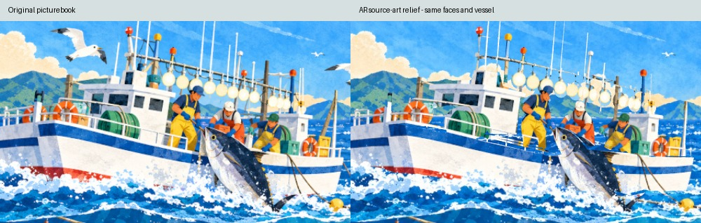
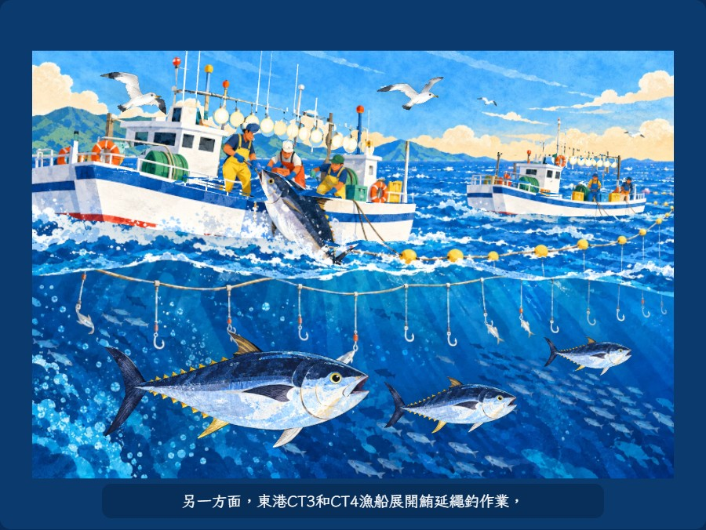
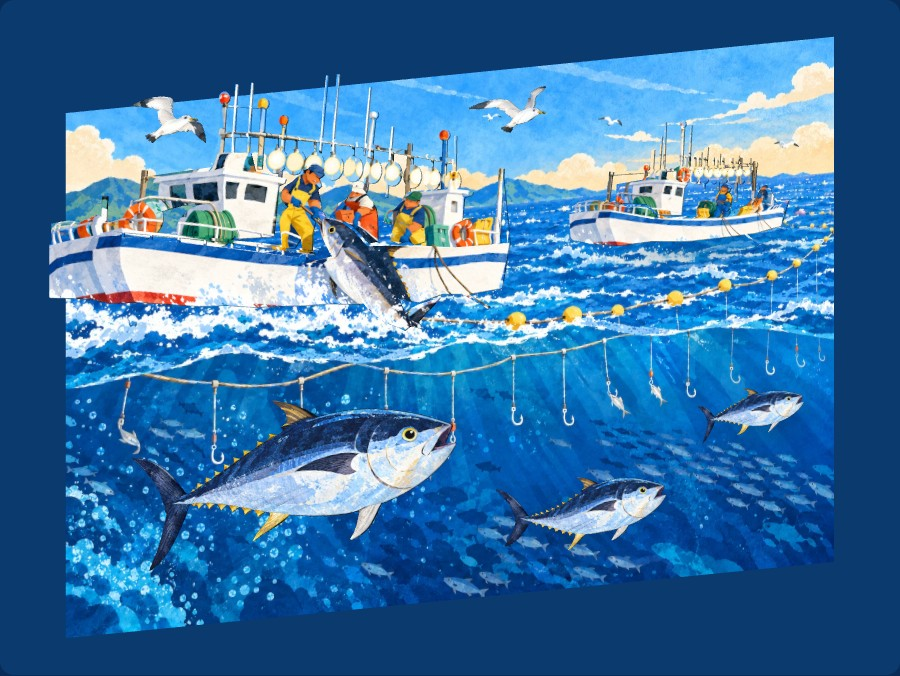
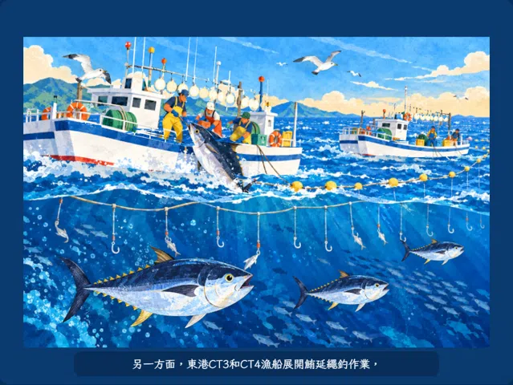

# 原畫還原、活潑動作與立體厚度驗證

2026-11-01。依使用者要求，修正船員與船型和繪本差異過大，同時讓魚活潑、增加動作與立體感。

船與船員改用原繪本影像直接映射到有圓弧厚度的封閉網格，保留臉孔、姿勢、服裝、船艙、船身、捲線機及燈架。這是保留原畫視角的立體浮雕造型；原畫未描繪的背面與被船遮住的身體沒有另行改畫。前景魚與海鷗保留既有完整角色網格。

## 外觀與動作

- 主船三位、後船兩位船員恢復原畫彎身作業姿勢；增加腰部小幅拉動、手部前後拉魚動作。繩索、工具與遮擋關係沿用原畫。
- 船艙、船體、設備、人物、燈具與船邊魚具有不同前後高度與實際封閉厚度。船體小幅起伏、燈具輕擺，保持原畫正向。
- 三條游魚加強尾鰭與腹鰭活動、上下起伏及小幅擺身；擺尾與路徑速度隨時間改變，保留原朝向、不整圈翻面。船邊魚的尾部另有掙動。
- 保留海鷗分別拍翅、滑翔、頭部穩定的上一輪改進。






## Windows 桌面 Chromium 自測

使用 Chromium 145、Playwright 與 `--autoplay-policy=user-gesture-required`。假相機由未更改的第 2 頁產生；一般測試未替換網站程式或 CDN。

| 項目 | 實測 |
|---|---|
| 原畫像素來源 | 船與人所有前表面貼圖直接來自 `assets/pages/p02.webp`；原檔未修改 |
| 三位主角臉部、兩處船身取樣 | 凍結動作、同視角渲染與原圖比對，平均絕對色差依序 0.0272、0.0595、0.0278、0.0027、0.0157／255 |
| 立體層閉合檢查 | 原畫船／人／設備共 23,568 三角形，每條網格邊恰有兩個相鄰面，開口／非流形邊 0 |
| 人物實際厚度 | 主船最小約 0.0285，後船約 0.01725 書頁寬單位；另實際看過斜視圖確認分層 |
| 動作與朝向 | 241 個動作取樣，三條游魚均有位移、變化的擺尾時鐘及小幅擺身；不整圈翻面。正常播放另取得三個時點狀態，確認動畫時鐘持續前進 |
| 逐角色與動畫圖 | 55 張完整度／角度圖；另看過三位原畫人物近照、原畫比對、斜視與實際動作取樣 |
| 固定視角、海鷗 | 481 個姿態／朝向取樣通過；兩隻海鷗各七張動作近照，頭部像素取樣維持穩定 |
| 直式俯視、輕斜視、兩種橫式 | 點擊到首次辨識約 2.968、2.375、2.375、2.375 秒；各三段字幕依序出現，遮住後可恢復 |
| 音訊與操作回歸 | 音訊延遲 6 秒仍繼續播放；預覽切 AR 無雙旁白；載入中返回可取消、所有相機 tracks 結束；連續進出三次通過 |
| 執行錯誤 | 上述測試無 pageerror 或 HTTP 4xx/5xx |

色差只代表指定臉部及船身取樣區，不代表整個 AR 場景與原畫逐像素相同；場景另含移動、立體厚度及清底。動態圖為瀏覽器畫面取樣重組，用來檢查動作，不是手機 FPS 基準。

真手機與紙本、LINE 外開、反光與手晃、實體喇叭，以及中階手機效能仍需使用者實測。辨識檔與旁白未更換。

## 重現與來源

從專案根目錄開 `python -m http.server 8000`，再執行：

```powershell
python ar/tools/verify_characters.py --mode original --out .ar-qa/original-art
python ar/tools/verify_characters.py --mode visual --out .ar-qa/original-art
python ar/tools/verify_characters.py --mode storybook --out .ar-qa/original-art
python ar/tools/verify_characters.py --mode ar --out .ar-qa/original-art
python ar/tools/verify_characters.py --mode regressions --out .ar-qa/original-art
python ar/tools/verify_characters.py --mode lifecycle --out .ar-qa/original-art
```

`--url` 可指向正式站，`--out` 可另存證據。新原畫模型在 [source-boat.js](../source-boat.js)，歷史素材來源在 [ASSET_NOTES](../ASSET_NOTES.md)。
