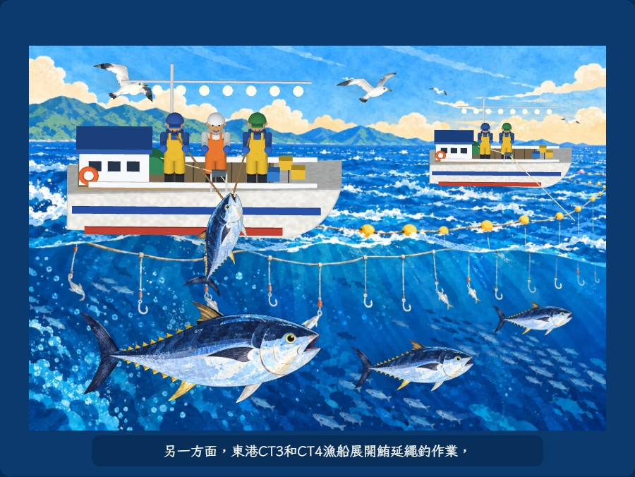
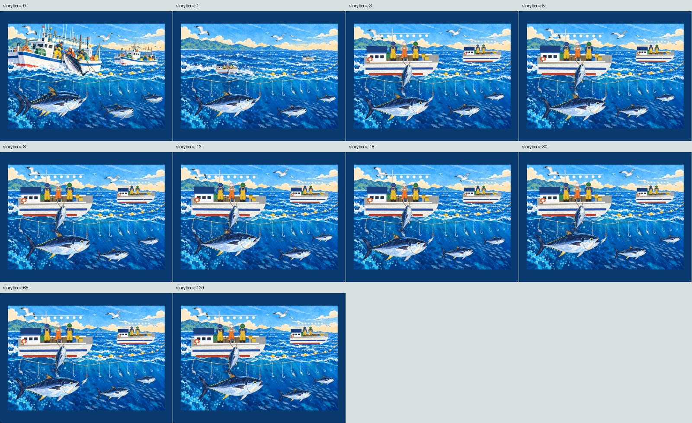
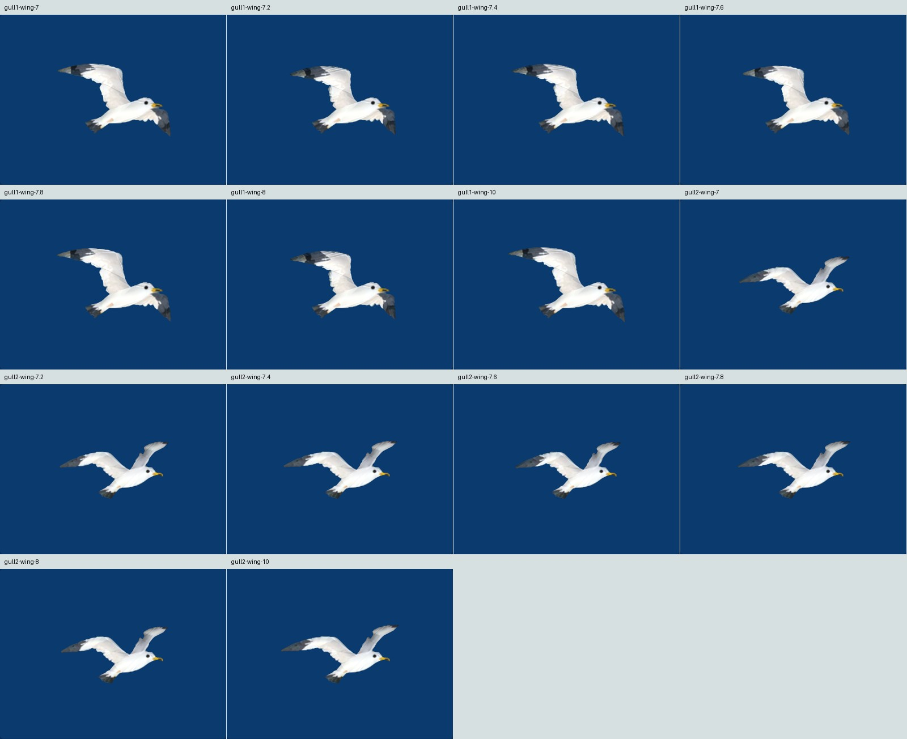

# 原繪本視角、海鷗與起魚修正驗證

2026-11-01。使用者確認上一版整體改善，接著要求海鷗自然、漁船符合起魚原理、船不翻面，所有視角回到原繪本。本輪在 PR #10 基礎上調整，沒有更換辨識檔、旁白、魚或海鷗貼圖。

## 最終呈現

- 預覽恢復原畫正向構圖並固定鏡頭；船艏向右、人物站正，魚和鳥維持原側向，只小幅位移。移除拖曳旋轉及滾輪改變視角。
- 船體在書頁座標中固定斜側姿態，只有輕微起伏，不會把船底翻給讀者看。AR 相機仍追蹤使用者實際拍攝的書頁；沒有宣稱手機從任意方向看都等於同一張平面照片。
- 海鷗使用完整網格的兩個肩關節變形，穿插拍翅與滑翔；身體維持等比例，頭與嘴受到保護。沒有用整隻鳥的上下壓縮來做拍翅。
- 起魚保留主船三位船員；一條收線經船舷導輪連到船外魚嘴，兩側船員以鉤竿協助，魚在船邊小幅抬動。後方船使用兩位船員、向海面收線，不再多吊一條魚。

起魚配置是依「先將魚帶到船邊，再由船員使用起魚鉤協助上船，大魚可能配合捲揚設備」原則所做的簡化繪本示意；單一線路、導輪位置及人物分工是本輪的畫面設計，並非完整船舶器具或力學模擬。依據：[IOTC Observer Manual，1.3.4.1，PDF 第 15 頁](https://iotc.org/sites/default/files/documents/2014/02/IOTC_Observer_Manual.pdf#page=15)。

## 已完成的桌面測試

Windows、Chromium 145、Playwright，嚴格自動播放政策。所有一般情境直接使用網站程式與 CDN，只有標示慢音訊的案例延遲音檔。

| 檢查 | 結果 |
|---|---|
| 正常 UI 拖曳與滾輪後鏡頭 | 位置、旋轉及縮放不變 |
| 0～120 秒、每 0.25 秒取樣 | 481 個姿態，兩船保持畫面向上、魚與鳥不沿路線轉向，無違反檢查 |
| 起魚連接 | 每個取樣均在船外，嘴部低於導輪；線端點與魚嘴連接點誤差 < 0.000001 場景單位；主船三人、後船兩人、兩支鉤竿 |
| 兩隻海鷗各七張近照 | 翅膀外形有變化；各六次與第一張比較，頭部 8×8 像素取樣區均無變化 |
| 原角色完整性驗證 | 55 張多角度及動畫圖完成，無 JS 或 HTTP 4xx/5xx 錯誤 |
| 四種假相機 | 俯視 2.203 秒、輕斜視 2.015 秒、橫式留邊 2.000 秒、橫式近距離 2.203 秒找到；各有三段字幕、遮擋後恢復 |
| 慢音訊與模式切換 | 延遲 6 秒後仍持續播放；預覽切 AR 時預覽聲音停止，AR 聲音持續 |

數值為特定桌面場景，含初始化與輪詢誤差，不是手機速度保證。481 個姿態是定點呼叫實際場景更新取得的幾何取樣；AR 播放與遮擋恢復另以即時假相機測試，兩者不混稱。

本機證據：`.ar-qa/storybook/`。重現：先從根目錄啟動 HTTP server，再執行 `python ar/tools/verify_characters.py --mode storybook --out .ar-qa/storybook`；其他 `visual`、`ar`、`regressions` 模式沿用。

真手機、紙本、LINE 外開、實際反光與手晃、人耳音量及中階機效能仍需實機確認。上一輪回歸與素材來源見 [前次報告](2026-11-01.md) 及 [素材紀錄](../ASSET_NOTES.md)。
