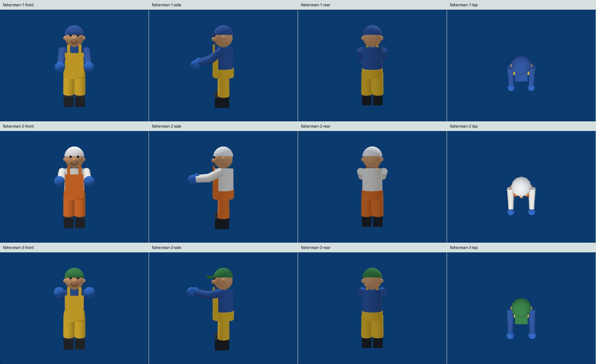
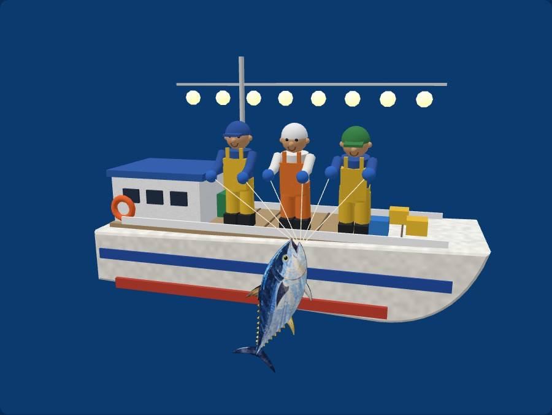
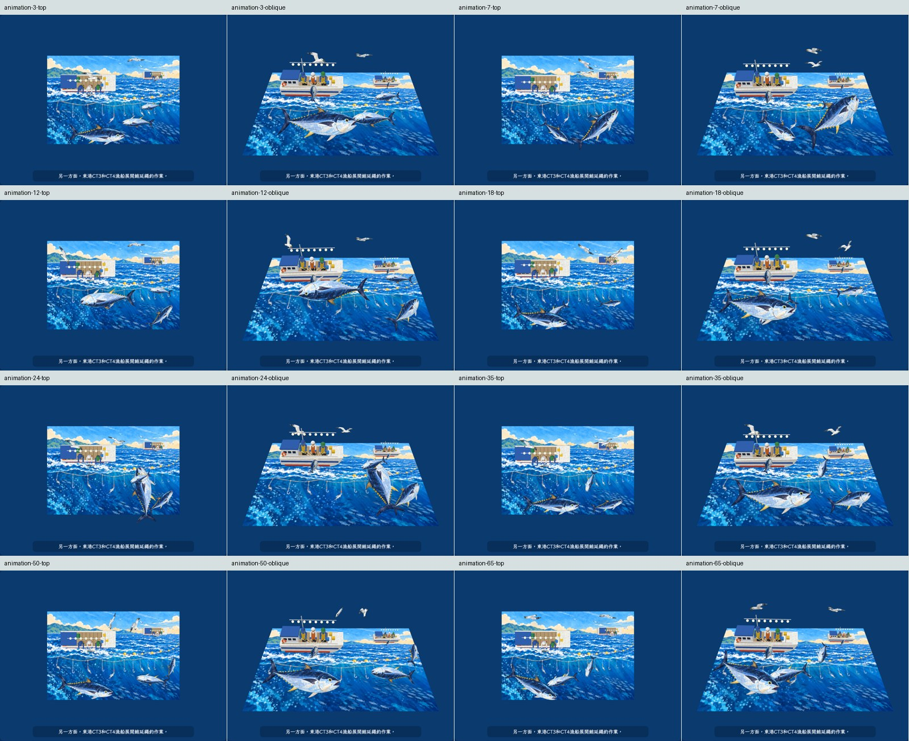

# 第 2 頁 AR 修正驗證（2026-11-01）

本輪修正缺尾鰭、魚身破洞、船圖破碎及主角完整性。以下是 Windows 桌面 Chromium 145 與 Playwright 的實測，使用原始繪本第 2 頁產生的假相機，不替代真手機或紙本驗收。原先兩份報告 `C:\temp\AR驗證\codex\report.md`、`C:\temp\AR驗證\v2\codex\report.md` 已讀取。

## 角色與畫面

- 共 55 張多角度截圖，已逐一開啟或用拼圖實際觀看：三條游魚、兩隻海鷗各四角度；主要三位漁夫各正面、側面、背面、俯視；整體及船體多角度；3、7、12、18、24、35、50、65 秒俯視及斜視取樣。
- 鮪魚新月尾、背鰭、腹鰭、胸鰭完整，魚身沒有原先的透明破洞；船邊魚亦使用同一完整模型。
- 三位漁夫可見完整帽子、頭、臉、身體、雙手、雙腿與靴子；關節連續，動作時手套及繩索跟著手臂。船體不再由 alpha 切圖網格製作，桅桿和燈具連續。從背面或俯視會自然遮擋部分身體，沒有宣稱每個角度都能同時看見所有表面。
- 清底覆蓋原畫主角，浮起後沒有原畫船身、人物與大魚的重複影像。魚群游動可能互相遮擋，取樣中未見破面或缺尾。
- 三個原始角色網格均通過每條邊恰有兩個相鄰三角形的檢查：tuna_complete 8,136、gull1 5,376、gull2 4,336 個三角形。此為幾何封閉性檢查，不是假稱完整魚類解剖模型。

## 功能回歸

使用 `--autoplay-policy=user-gesture-required`，未攔截一般情境的 CDN 或替換程式。

| 假相機情境 | 點擊到首次辨識 | 三段字幕 | 遮擋後恢復 | pageerror / HTTP 4xx、5xx |
|---|---:|---|---|---|
| 直式俯視 | 2.531 秒 | 通過 | 通過 | 0 / 0 |
| 直式輕微斜視 | 2.031 秒 | 通過 | 通過 | 0 / 0 |
| 橫式整頁留邊 | 2.078 秒 | 通過 | 通過 | 0 / 0 |
| 橫式近距離 | 2.172 秒 | 通過 | 通過 | 0 / 0 |

這些時間包含初始化、載入與輪詢誤差，不是手機效能保證。各 24 秒觀察含第 9～12 秒整頁遮擋；全部曾暫停並在重新看見頁面後接續。

- 預覽：素材準備後才播放，音訊時間前進、未暫停。拖曳旋轉與縮放使用 OrbitControls。
- 慢音訊：只延遲音訊下載 6 秒，辨識成功後音訊由 3.390 增至 4.909 秒、`paused=false`，沒有被晚完成的解鎖歸零。
- 預覽切 AR：預覽 `paused=true`，AR `paused=false` 且時間前進，沒有雙播放器同播。
- 載入取消：將網格下載延遲 5 秒後按返回；回到介紹頁、沒有 AR engine、音訊暫停、所有相機 tracks 已結束。
- 背景恢復入口：用合成 visibility 事件驗證暫停及回前景的續播按鈕，點擊後繼續。**這不是手機 OS 真正切 App 實測。**
- 連續進出三次：每次可辨識並返回，每次離開所有相機 tracks 均結束，沒有 JS 或 HTTP 錯誤。
- Three.js/MindAR 原有 `outputEncoding` 相容警告仍在，未將其隱藏或當成致命錯誤。

## 範圍與剩餘實測

目前仍只做第 2 頁。未宣稱所有透視角度可首次辨識；先前明顯斜視失敗的情境不在本輪通過範圍，介面引導先正對、整頁留邊，找到後再稍微斜看。辨識檔 `p02.mind` 未更換。

仍待使用者以 iPhone Safari、Android Chrome、LINE 掃 QR 對紙本實測：辨識容忍度、手晃、彎頁與反光、真實喇叭聲音、背景與螢幕旋轉，以及中階手機 FPS/發熱。桌面測試沒有涵蓋這些項目。

本機原始 JSON、55 張完整 PNG、假相機輸入均在 `.ar-qa/`，不提交 690 MB 測試影片。重現命令與依賴見 [WORKLOG](../WORKLOG.md) 及 `ar/tools/verify_characters.py`，可用 `--url` 指向正式站、`--out` 指定獨立證據目錄。

新素材由內建 imagegen 補繪，來源、保存位置與提示詞見 [ASSET_NOTES](../ASSET_NOTES.md)。原畫、舊切圖、辨識檔、旁白音檔均保留。
