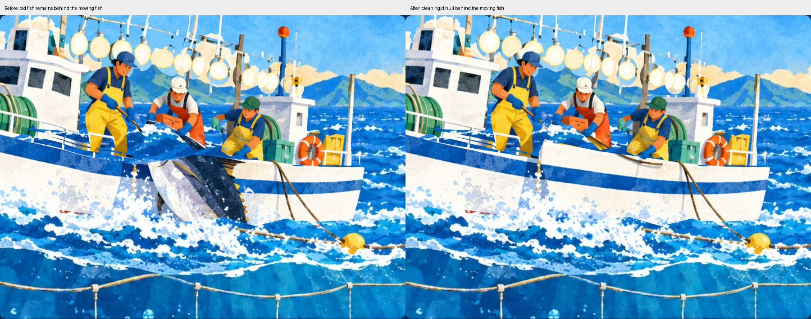
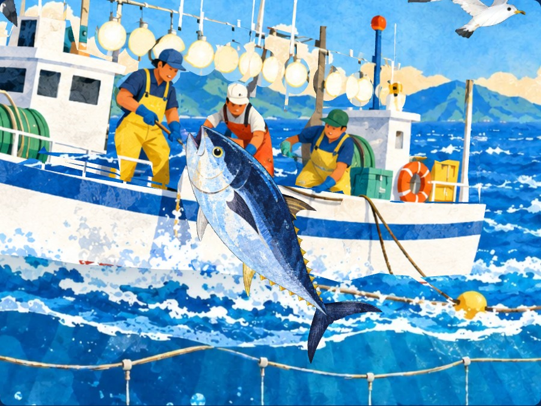
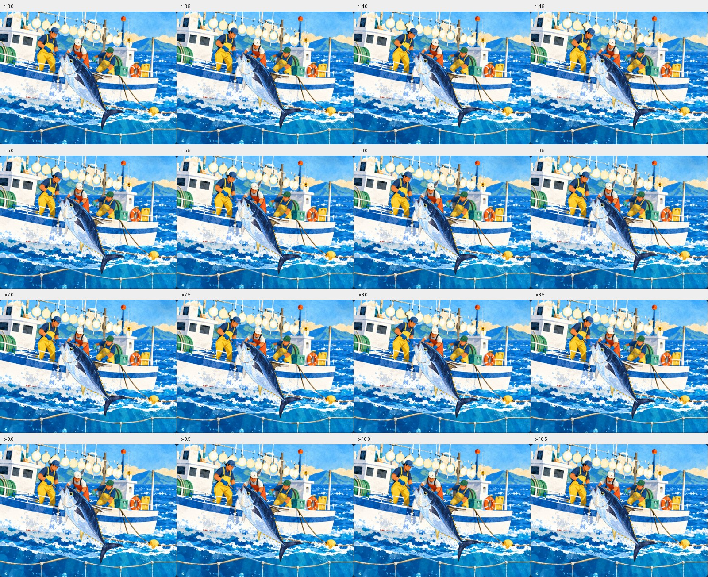

# 船殼形狀與鮪魚殘影驗證

2026-11-02。依使用者截圖重現局部船殼被拉動、船邊魚後方留有殘圖的問題。以下數值為 Windows 桌面 Chromium 145 本機驗證；正式站在交付前另行核對與重測。

## 原因及修正

主船材質會在舊魚輪廓內換成補底圖，遠船材質沒有這段 shader。兩者原本共用 `onBeforeCompile` 函式文字所產生的預設快取鍵，導致主船可能拿到遠船編譯的程式；這時換成完整活動魚仍會在船面留下原圖舊魚。上一輪只驗活動魚的連續性，沒有把活動魚隱藏後查看後方，因此漏掉此問題。

現在依主船／遠船分開快取鍵，驗證用白色遮罩及黑色遮擋材質也各自分開。活動魚隱藏後，船面確實露出乾淨補底。人物變形另外改成按船員輪廓指定權重，建模時加入船體／人物的內部分界，船殼、船艙、設備的權重全部為零，避免三角形跨越分界把船身一起拉動；補齊原魚遮住的船舷輪廓。保留整艘船小幅起伏及船員拉魚，船殼維持固定形狀。

鮪魚升起完成後採不透明、寫入深度的材質；入場淡入仍保留。原圖、辨識檔、旁白及既有補底圖未改，這輪沒有新增生成式素材。





## 本機結果

使用嚴格的 `--autoplay-policy=user-gesture-required`。船體局部穩定檢查會凍結整船的起伏／微轉，讓局部變形無法被整體移動混淆；正常播放圖仍保留原來的起伏。

| 檢查 | 結果 |
|---|---|
| 舊魚殘圖檢查區域 | 隱藏活動魚，獨立取原魚與船殼相交的區域，共 26,122 個畫面像素，和無魚補底材質的實際渲染比較 |
| 故意共用錯誤鍵的負向對照 | 重新編譯後可重現舊魚，平均 RGB 差約 100.81／255，會被驗證攔下，確認測試真的能抓到這次的錯誤 |
| 遠船先編譯、主船先編譯 | 兩種情況都通過；檢查區平均 RGB 差小於 0.0001／255，最大差 1／255 |
| 船殼權重 | 直接檢查主船所有屬於船殼／船艙／設備的 20,033 個三角形（含前後及部分側面），所有動作權重都是 0 |
| 船殼連續畫面 | 3.0～12.5 秒，共 96 個 GPU 時點，固定整船位置後比較，最大 RGB 變化 1／255；局部形狀不變 |
| 活動魚與周圍的前幀殘留 | 16 個時點，先畫其他姿態，再畫指定姿態，和明確清空畫布後的同一姿態比較；整魚前後位置與周圍區域最大差 1／255，在光柵取樣容差內 |
| 魚材質狀態 | 上述 16 個時點均為 opacity=1、transparent=false、depthWrite=true |
| 整隻魚與完整頭部 | 沿用 `verify_catch.py`，96 個魚形及 96 個頭部時點通過；魚形無缺失、斷開、內部洞，頭部最大差約 0.0274%（含邊界容差） |
| 彩色多角度 | 正面、左斜、右斜各 16 張，共 48 張，另有 32 張正常播放取樣，已檢視船邊與魚尾周圍 |
| 封閉網格 | 兩艘船共 42,852 個三角形，開口／非流形邊 0；左側漁夫完整頭部的六個輪廓地標通過 |
| 原畫顏色取樣 | 三位臉部與兩處船身平均絕對色差依序 0.0272、0.0298、0.0139、0.0027、0.0107／255 |
| AR 假相機 | 直式正面、輕斜、橫式留邊、橫式四種輸入均通過；首次辨識約 2.938、2.797、2.829、2.969 秒，每種都有三段字幕、正常旁白，退出後音訊停止、renderer 清除 |
| 音訊回歸 | 延遲音訊 6 秒仍播放，預覽切 AR 沒有雙旁白 |
| 操作回歸 | 載入中返回可取消、相機 tracks 全部結束；回前景的續播按鈕及連續進出三次通過 |
| 執行錯誤 | 上述本機測試無 pageerror、console error 或 HTTP 4xx/5xx |



白色遮罩、空船面及故意錯誤的材質快取只用於驗證。正常模式的 48 張彩色圖及正常播放取樣未替換網站材質。RGB 1／255 為瀏覽器光柵化／8 位元取樣容差，不宣稱所有像素完全相等。真手機、紙本、LINE、實體喇叭及手機效能仍需實測。

## 重現

先在根目錄開 `python -m http.server 8000 --bind 127.0.0.1`，另開終端：

```powershell
python ar/tools/gen_source_boat.py
python ar/tools/verify_hull.py --out .ar-qa/hull-wake
python ar/tools/verify_catch.py --out .ar-qa/hull-wake/catch-final
python ar/tools/verify_characters.py --mode original --out .ar-qa/hull-wake/original
python ar/tools/verify_characters.py --mode ar --out .ar-qa/hull-wake/ar
python ar/tools/verify_characters.py --mode regressions --out .ar-qa/hull-wake/regressions
python ar/tools/verify_characters.py --mode lifecycle --out .ar-qa/hull-wake/lifecycle
```

各驗證程式皆可使用 `--url` 指向正式站。建置需要 `numpy`、`shapely>=2`、`triangle`，瀏覽器驗證另需 `Pillow`、`opencv-python`、`scipy`、`playwright` 及既有 Chromium。完整原尺寸圖與 JSON 保留於本機 `.ar-qa/hull-wake/`；精簡結果見 [checks.json](hull-wake/checks.json)。
